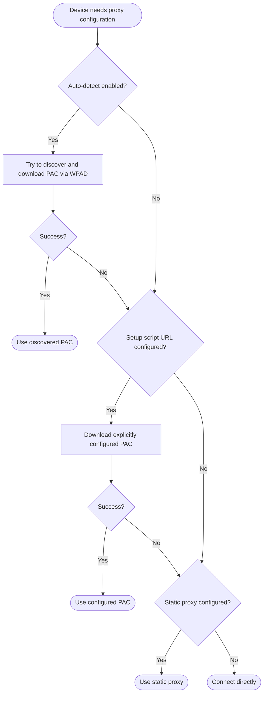
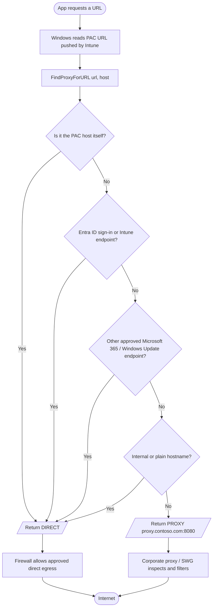
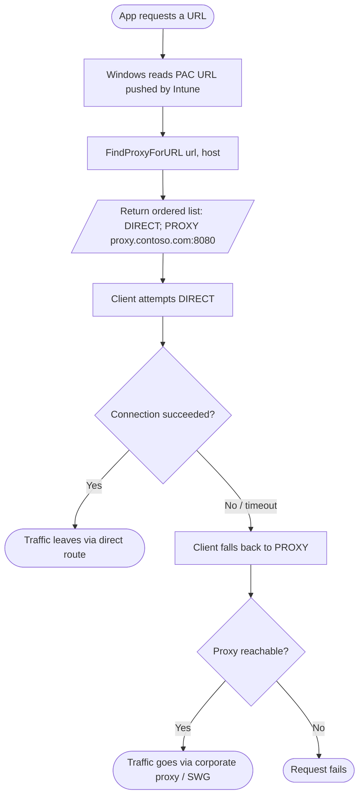
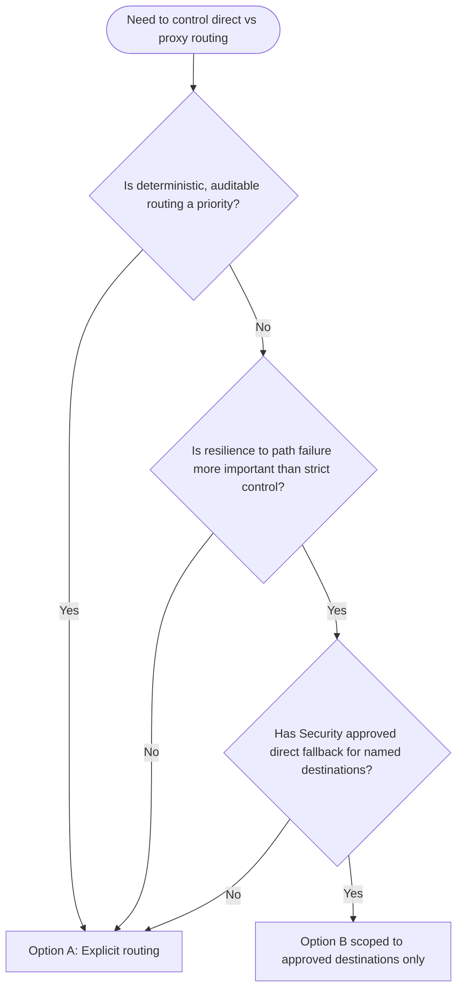

# Intune + PAC File: "Direct" vs "Proxy" Routing for a Managed Windows Estate

> **Goal:** Control whether managed Windows devices connect **directly** to the Internet or go **via the corporate proxy**, using Intune to deploy the configuration.
>
> **Key principle:** *Intune delivers configuration. The PAC file makes the routing decision. The proxy/SWG secures traffic. The firewall decides what DIRECT traffic is allowed.*

---

## 1. Summary of the two options

| | **Option A: Explicit routing (recommended)** | **Option B: Connection fallback** |
|---|---|---|
| **Idea** | PAC decides per destination: DIRECT for approved destinations, PROXY for the rest | PAC returns an ordered list (e.g. `DIRECT; PROXY ...`) and the client falls through the list if a connection fails |
| **Behaviour** | Deterministic: the same URL always takes the same path | Dynamic: the path depends on whether a connection attempt succeeds |
| **Predictability / audit** | High | Lower |
| **Troubleshooting** | Easy (read the PAC rule) | Harder (need to see which attempt failed and why) |
| **Security posture** | Strong: only named destinations bypass the proxy | Weaker if Internet-wide DIRECT is attempted first, because the proxy can be bypassed whenever direct works |
| **Risk** | Missing an endpoint in the DIRECT list | Direct attempts that hang before the fallback (timeout behaviour is client-specific; **validate in a pilot**) |
| **Best for** | Most managed estates | Specific scenarios where network/security teams explicitly accept "try direct first" |

---

## 2. Common foundation (applies to both options)

### 2.1 How Windows evaluates proxy configuration from the NetworkProxy CSP

The NetworkProxy CSP configures a proxy for **Ethernet and Wi-Fi** connections (it **does not apply to VPN connections**). Windows evaluates it in this order [1]:



> **Important distinction:** this CSP sequence is about **finding the proxy configuration**. It is **not** the same as the PAC file's own `DIRECT` / `PROXY` routing decision per URL.

### 2.2 Deploy the PAC URL with Intune

1. **Host the PAC file** at a stable HTTPS URL, e.g. `https://pac.contoso.com/proxy.pac`.
   - Reachable from corporate LAN, Wi-Fi, home and VPN-off networks.
   - No authentication and no proxy dependency to fetch the PAC itself.
2. In the **Intune admin center**: **Devices > Windows > Configuration > Create > New policy**.
3. Platform: **Windows 10 and later**. Use a profile that exposes **Network proxy** (Device Restrictions template or Settings catalog) [2].
4. Configure:

| Setting | Value |
|---|---|
| Automatically detect proxy settings | **Block** (disabled) |
| Use proxy script | **Allow** |
| Setup script address URL | `https://pac.contoso.com/proxy.pac` |
| Use manual proxy server | Not configured |

   Microsoft Q&A guidance notes that setting auto-detect to *Block* sets `ProxySettingsPerUser` to 0 [2].

5. Assign first to a **pilot group** (e.g. `GRP-Windows-PAC-Pilot`), then expand.
6. Check for **legacy GPO / registry proxy settings** that conflict with the MDM policy. Policy conflicts are a common cause of proxy profile failures (e.g. error `0x87d101f4` was reported in this scenario) [2].

> **Tip:** The underlying CSP nodes are `./Vendor/MSFT/NetworkProxy/AutoDetect` (0 = disabled, 1 = enabled, default 1) and `./Vendor/MSFT/NetworkProxy/SetupScriptUrl` [1].

### 2.3 Build the Microsoft endpoint list from the source, not by hand

Microsoft's `Get-PacFile.ps1` generates a PAC file from the current Microsoft 365 Optimize/Allow endpoints [3]:

```powershell
Install-Script -Name Get-PacFile

& 'C:\Program Files\WindowsPowerShell\Scripts\Get-PacFile.ps1' `
    -Type 2 `
    -Instance Worldwide `
    -TenantName Contoso `
    -ClientRequestId (New-Guid).Guid `
    -DefaultProxySettings 'PROXY proxy.contoso.com:8080' |
    Out-File -FilePath "$HOME\Downloads\proxypac.js" -Encoding ASCII
```

> **Watch the wildcard trap:** `*.teams.microsoft.com` matches `foo.teams.microsoft.com` but **not** `teams.microsoft.com` itself. Add both the wildcard and the apex host. Also remember PAC files are evaluated **top-down**, so rule order matters [3].

---

## 3. Option A: Explicit routing (recommended)

### 3.1 Concept

The PAC file names exactly what goes **DIRECT**; everything else goes through the **proxy**.

### 3.2 Flowchart



### 3.3 Example PAC file

```javascript
function FindProxyForURL(url, host)
{
    // 1. PAC hosting endpoint itself
    if (dnsDomainIs(host, "pac.contoso.com"))
        return "DIRECT";

    // 2. Microsoft identity
    if (host === "login.microsoftonline.com")
        return "DIRECT";

    // 3. Intune (apex and sub-domains)
    if (host === "manage.microsoft.com" ||
        shExpMatch(host, "*.manage.microsoft.com"))
        return "DIRECT";

    // 4. Windows Update (example only - build the real list from Microsoft's endpoint documentation)
    if (shExpMatch(host, "*.windowsupdate.com"))
        return "DIRECT";

    // 5. Internal resources
    if (isPlainHostName(host) ||
        shExpMatch(host, "*.contoso.local"))
        return "DIRECT";

    // 6. Everything else goes through the corporate proxy
    return "PROXY proxy.contoso.com:8080";
}
```

> The Entra ID / DIRECT-plus-PROXY-for-everything-else pattern mirrors the example Microsoft publishes for Global Secure Access PAC files [4].

### 3.4 Step-by-step

| Step | Action | Owner |
|---|---|---|
| 1 | Define which destinations must be DIRECT (Intune, Entra ID, Windows Update, Delivery Optimization, M365 Optimize/Allow, internal) | Network / Security |
| 2 | Generate the Microsoft portion with `Get-PacFile.ps1`, then add your own rules | Endpoint / Network |
| 3 | Host the PAC at a highly available HTTPS URL, excluded from proxy dependency | Network |
| 4 | Create the Intune **Network proxy** profile (auto-detect **Block**, script **Allow**, URL) | Intune admin |
| 5 | Assign to pilot group | Intune admin |
| 6 | Test on LAN, Wi-Fi, home Internet, hotspot, VPN on/off | Endpoint team |
| 7 | Validate Edge **and** system services (see section 5) | Endpoint team |
| 8 | Align the firewall so DIRECT is allowed **only** for approved destinations | Network / Security |
| 9 | Expand assignment in rings | Intune admin |
| 10 | Review PAC rules on a schedule as Microsoft endpoints change | Network |

### 3.5 Pros and cons

| Pros | Cons |
|---|---|
| Deterministic, easy to audit and support | Needs the DIRECT list maintained |
| Strong security posture | A missed endpoint is sent to the proxy and may break (e.g. TLS inspection with certificate-pinned services) |
| Easy to troubleshoot (read the rule) | Requires coordination between Intune, network and security teams |

---

## 4. Option B: Connection fallback ("try DIRECT first, then PROXY")

### 4.1 Concept

The PAC file returns an **ordered list**. The client tries each entry until one works.

```javascript
return "DIRECT; PROXY proxy.contoso.com:8080";
```

The reverse ordering (`PROXY proxy...; DIRECT`) is also common and appears in the example from a previous internal reply on OneDrive PAC testing [5].

### 4.2 Flowchart



### 4.3 Example PAC file (scoped, safer variant)

Limit "direct first" to specific destinations rather than the whole Internet:

```javascript
function FindProxyForURL(url, host)
{
    // PAC host always direct
    if (dnsDomainIs(host, "pac.contoso.com"))
        return "DIRECT";

    // Approved Microsoft destinations: try direct first, proxy as backup
    if (host === "manage.microsoft.com" ||
        shExpMatch(host, "*.manage.microsoft.com") ||
        host === "login.microsoftonline.com")
        return "DIRECT; PROXY proxy.contoso.com:8080";

    // Internal
    if (isPlainHostName(host) || shExpMatch(host, "*.contoso.local"))
        return "DIRECT";

    // Everything else: proxy only (no direct bypass)
    return "PROXY proxy.contoso.com:8080";
}
```

### 4.4 Step-by-step

| Step | Action | Owner |
|---|---|---|
| 1 | Get **explicit security approval** for any destination that may fall back to DIRECT | Security |
| 2 | Decide scope: approved Microsoft endpoints only (recommended) vs broad Internet | Network / Security |
| 3 | Write PAC with ordered return values for the in-scope destinations | Network |
| 4 | Deploy the same Intune **Network proxy** profile as Option A (section 2.2) | Intune admin |
| 5 | **Measure failure behaviour:** block direct egress in a test and record how long clients wait before falling back | Endpoint team |
| 6 | Verify the firewall's behaviour (drop vs reject) because it affects fallback delay | Network |
| 7 | Test Edge, WinHTTP / SYSTEM services and VPN scenarios | Endpoint team |
| 8 | Monitor proxy logs for traffic you expected to be direct, and vice versa | Network |

### 4.5 Pros and cons

| Pros | Cons |
|---|---|
| Resilient if either path is unavailable | Fallback timing is client-dependent, so users may see delays |
| Fewer hard failures for edge cases | Harder to reason about, audit and support |
| Useful for hybrid / roaming scenarios | Broad "DIRECT first" can bypass the proxy and weaken security controls |

> **Caveat:** I have not found Microsoft documentation that defines exact fallback timing for Windows clients, so treat any timing assumptions as unverified until you test them in your pilot.

---

## 5. Validation (PowerShell)

### 5.1 Is the PAC being applied?

```powershell
# Current user (WinINET) proxy settings
Get-ItemProperty 'HKCU:\Software\Microsoft\Windows\CurrentVersion\Internet Settings' |
    Select-Object AutoConfigURL, AutoDetect, ProxyEnable, ProxyServer

# Can the device retrieve the PAC file?
Invoke-WebRequest -Uri 'https://pac.contoso.com/proxy.pac' -UseBasicParsing |
    Select-Object StatusCode, @{n='Length';e={$_.Content.Length}}
```

### 5.2 WinHTTP (system / service context)

```powershell
netsh winhttp show proxy
```

> WinHTTP-based apps do not natively support WPAD auto-detect. For services that use WinHTTP, you can import the current WinINET proxy settings (excluding WPAD) with `netsh winhttp import proxy source=ie` [6]. Test this in a pilot before rolling it out.

### 5.3 Intune delivery check

- Policy > **Device assignment status** report in Intune.
- On the client: **Event Viewer > Applications and Services Logs > Microsoft > Windows > DeviceManagement-Enterprise-Diagnostics-Provider > Admin** [7].

### 5.4 Test matrix

| Scenario | Edge (user) | WinHTTP / SYSTEM services | Intune Management Extension | Notes |
|---|---|---|---|---|
| Corporate LAN | ☐ | ☐ | ☐ | |
| Corporate Wi-Fi | ☐ | ☐ | ☐ | |
| Home Internet | ☐ | ☐ | ☐ | PAC must be reachable off-network |
| Mobile hotspot | ☐ | ☐ | ☐ | |
| VPN connected | ☐ | ☐ | ☐ | **NetworkProxy CSP doesn't apply to VPN connections** [1] |
| VPN disconnected | ☐ | ☐ | ☐ | |

---

## 6. Decision guide



**Recommendation:** Start with **Option A**. Add **Option B** only for a short, security-approved list of destinations if you can demonstrate a resilience need during the pilot.

---

## 7. Known limitations and open questions

| Item | Status |
|---|---|
| NetworkProxy CSP doesn't apply to **VPN** connections | Documented [1] |
| WinHTTP doesn't natively support WPAD auto-detect | Documented in a Microsoft product TSG [6] |
| Exact fallback timeout when DIRECT fails | **Not found in documentation. Test in your environment** |
| Whether IME / Company Portal honour user PAC vs WinHTTP | **Not confirmed. Include in acceptance testing** |
| Intune has no dedicated "test direct, then proxy" connectivity setting | I found no such setting. Routing is done via PAC and Windows proxy settings |

---

## References

1. [NetworkProxy CSP | Microsoft Learn](https://learn.microsoft.com/en-us/windows/client-management/mdm/networkproxy-csp)
2. [Microsoft Intune custom configuration profile for corporate proxy settings, Microsoft Q&A](https://learn.microsoft.com/en-us/answers/questions/5916494/microsoft-intune-custom-configuration-profile-for)
3. Internal training deck: *1.5 Microsoft 365 Network Fundamentals for Teams Support Agents* (PAC files, `Get-PacFile.ps1`, wildcard pitfall)
4. [Proxy Automatic Configuration (PAC), Global Secure Access | Microsoft Learn](https://learn.microsoft.com/en-us/entra/global-secure-access/concept-proxy-automatic-configuration-files)
5. Sent email: *Re: Ref Pac file* (20 Nov 2024), PAC fallback example and testing approach
6. Internal TSG: *How to configure proxy settings using a PAC file* (WinHTTP and WPAD support notes)
7. [Using Microsoft Intune Custom Policies, TheSleepyAdmins](https://thesleepyadmins.com/2025/04/17/using-microsoft-intune-custom-policies/) (client log location and assignment report)
