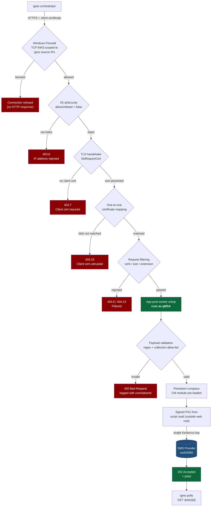
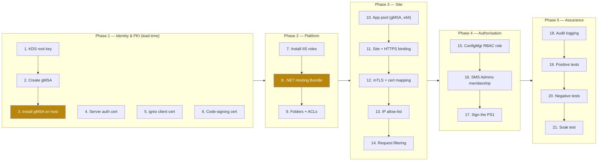
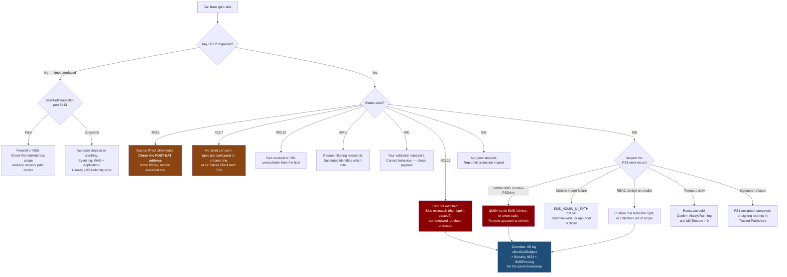

# ConfigMgr Trigger Endpoint — Manual Setup & Validation Guide

**Purpose:** Replace fragile `Invoke-Command` remoting from ignio with an authenticated HTTPS trigger endpoint that executes a signed, local ConfigMgr PowerShell script under a fixed service identity.

**Audience:** Customer platform / ConfigMgr administrators, with CSA oversight.
**Change class:** Medium — new site system-adjacent service. Requires PKI, AD and firewall changes.
**Estimated build time:** 3–4 hours, plus PKI lead time for certificate issuance.

> **DISCLAIMER**
> This guide describes a custom integration. It is provided as-is and is not covered by any Microsoft standard support programme. The customer owns the endpoint code, its lifecycle and its security posture. Validate in a non-production hierarchy first.

---

## 1. Why this design

The current failure is **not an SCCM defect**. The script works locally and fails under `Invoke-Command`, which isolates the fault to the remote execution context — specifically the Kerberos second hop from the WinRM target to the SMS Provider, plus WinRM quota and identity variability under orchestration load.

This endpoint removes the second hop by inverting the model:

| | Current (broken) | Target (this guide) |
|---|---|---|
| Transport | WinRM / `Invoke-Command` | HTTPS + mutual TLS |
| Hop 1 | ignio → site server | ignio → endpoint (authenticated, terminates here) |
| Hop 2 | site server → SMS Provider **(credential lost)** | *None* — app pool identity holds its own TGT |
| Identity | Delegated, variable | Fixed gMSA, deterministic |
| Failure mode | Intermittent `0x80070005` | Deterministic HTTP status codes |
| Blast radius | Whatever the caller can do | One custom RBAC role, one collection |

### The single rule that must not be broken

> **Authenticate the caller. Then act as the service identity. Never impersonate.**

If Windows Authentication with impersonation is enabled so that ConfigMgr work runs as the *calling* ignio account, the Kerberos double-hop is recreated inside IIS and the original intermittent fault returns — but now harder to diagnose, because it is buried behind a web tier.

---

## 2. Placement decision — read before you build

Microsoft's guidance is to keep site system roles separate from the site server for security and operational resilience <cite>turn2search106</cite>. That principle applies here.

| Option | Verdict | Rationale |
|---|---|---|
| **Dedicated member server** with the ConfigMgr console installed | **Recommended** | Isolated IIS. Site resets, role reinstalls and CU upgrades on the primary cannot disturb the endpoint. No additional licence cost. |
| **Primary site server's existing IIS** | Acceptable with caveats | Fewer moving parts, no extra host. But the endpoint shares an IIS instance with MP/DP/SUP roles; a site reset can overwrite IIS configuration, and any endpoint compromise is on the site server itself. |

If the customer insists on the primary site server, use a **dedicated site, dedicated application pool and a non-default port (8443)** — never the Default Web Site. Everything in this guide is written to work either way.

---

## 3. Architecture and request flow



**Read the diagram as a security argument:** a request must survive six independent gates before any ConfigMgr call happens. Each gate fails closed and returns a distinct, greppable status code.

---

## 4. Build sequence and dependencies

Order matters. Two ordering mistakes account for most failed builds.



> **Ordering trap 1 — Hosting Bundle before IIS.** If the .NET Hosting Bundle is installed *before* IIS, the installation must be repaired (re-run the installer) or the ASP.NET Core Module will be absent <cite>turn2search88</cite>.
>
> **Ordering trap 2 — gMSA before reboot.** `Install-ADServiceAccount` only succeeds after the host is a member of the gMSA's `PrincipalsAllowedToRetrieveManagedPassword` group *and* has picked up that membership — which normally requires a reboot.

---

## 5. Pre-flight checklist

Complete **all** of this before touching IIS. Missing items here cause failures that surface much later and look unrelated.

| # | Item | Owner | Done |
|---|---|---|---|
| 1 | Host chosen and agreed (dedicated member server preferred) | Platform | ☐ |
| 2 | ConfigMgr console installed on the host, same build as the site | ConfigMgr | ☐ |
| 3 | KDS root key exists in the forest | AD | ☐ |
| 4 | gMSA created; host added to `PrincipalsAllowedToRetrieveManagedPassword`; host rebooted | AD | ☐ |
| 5 | Server authentication certificate issued to the endpoint FQDN, private key present | PKI | ☐ |
| 6 | Client authentication certificate issued to ignio; **Base64 `.cer` exported** for pinning | PKI | ☐ |
| 7 | Code-signing certificate available; its root trusted on the host | PKI | ☐ |
| 8 | CRL / OCSP endpoints reachable from the host | Network | ☐ |
| 9 | ignio **egress** source IPs confirmed — post-NAT, post-proxy | Network | ☐ |
| 10 | Firewall change raised for TCP 8443 from those IPs only | Network | ☐ |
| 11 | Target collection ID(s) agreed and documented | ConfigMgr | ☐ |
| 12 | Non-production hierarchy available for the first build | ConfigMgr | ☐ |
| 13 | Rollback plan agreed and change record raised | Change | ☐ |

> **Item 9 is the one that bites.** The IP allow-list sees the *connecting* address. If ignio sits behind a NAT gateway, proxy or load balancer, the list silently becomes worthless while still appearing correctly configured. Confirm the real egress address by capture, not by assumption. Treat the IP filter as defence in depth — **mutual TLS is the control you actually rely on.**

---

## 6. Step-by-step build

Each step below has a **Do** and a **Validate**. Do not proceed past a failed validation — later steps will produce misleading errors.

### Step 1 — Create the KDS root key (once per forest)

**Do** *(on a domain controller)*
```powershell
if (-not (Get-KdsRootKey)) {
    Add-KdsRootKey -EffectiveImmediately   # available after ~10h + AD replication
}
```

**Validate**
```powershell
Get-KdsRootKey | Select-Object KeyId, EffectiveTime
```
✅ **Pass:** at least one key returned with an `EffectiveTime` in the past.
❌ **Fail:** empty result, or `EffectiveTime` in the future — wait for the 10-hour window.

---

### Step 2 — Create and install the gMSA

The gMSA gives a fixed identity with an automatically managed password, retrieved by the domain controller rather than stored on the host <cite>turn2search101</cite>. It cannot log on interactively and cannot be locked out.

**Do** *(on a DC or RSAT host)*
```powershell
$hostGroup = 'CM-TriggerEndpoint-Hosts'
New-ADGroup -Name $hostGroup -GroupScope Global -GroupCategory Security -Path 'OU=Groups,DC=contoso,DC=com'
Add-ADGroupMember -Identity $hostGroup -Members 'CM01$'    # the endpoint host computer account

New-ADServiceAccount -Name 'svc-cmtrigger' `
    -DNSHostName 'cm01.contoso.com' `
    -PrincipalsAllowedToRetrieveManagedPassword $hostGroup `
    -ServicePrincipalNames 'HTTP/cmtrigger.contoso.com'
```

**Reboot the endpoint host**, then:
```powershell
Install-ADServiceAccount -Identity 'svc-cmtrigger'
```

**Validate** *(on the endpoint host)*
```powershell
Test-ADServiceAccount -Identity 'svc-cmtrigger'
```
✅ **Pass:** `True`.
❌ **Fail:** `False` — the host is not in the retrieval group, or has not rebooted since being added. Confirm with `Get-ADServiceAccount svc-cmtrigger -Properties PrincipalsAllowedToRetrieveManagedPassword`.

---

### Step 3 — Install IIS role services

**Do**
```powershell
Install-WindowsFeature -Name Web-Server, Web-Http-Logging, Web-Filtering,
    Web-IP-Security, Web-Cert-Auth, Web-Mgmt-Console, Web-Scripting-Tools
```

`Web-Cert-Auth` provides IIS client certificate mapping authentication, which is **not present in a default IIS installation** and must be added explicitly <cite>turn2search93</cite>.

**Validate**
```powershell
Get-WindowsFeature Web-Cert-Auth, Web-IP-Security, Web-Filtering |
    Select-Object Name, InstallState
```
✅ **Pass:** all three `Installed`.
❌ **Fail:** any `Available` — the corresponding hardening step will silently do nothing.

---

### Step 4 — Install the .NET Hosting Bundle

**Do:** install the current .NET Hosting Bundle. **If IIS was installed after the bundle, re-run the installer to repair it** <cite>turn2search88</cite>. On older OS builds the Visual C++ Redistributable is also required, otherwise the event log reports an opaque *"The data is the error"* message <cite>turn2search88</cite>.

**Validate**
```powershell
Import-Module WebAdministration
Get-WebGlobalModule | Where-Object Name -like 'AspNetCore*'
(Get-Item 'C:\Program Files\IIS\Asp.Net Core Module\V2\aspnetcorev2.dll').VersionInfo.ProductVersion
```
✅ **Pass:** `AspNetCoreModuleV2` listed, DLL version returned.
❌ **Fail:** module absent → repair the bundle, then `iisreset`.

---

### Step 5 — Create folders and apply ACLs

Three folders, three different security intents:

| Folder | Purpose | gMSA rights |
|---|---|---|
| `E:\inetpub\cmtrigger` | Web root (published API only) | Read |
| `E:\CMAutomation\Scripts` | **Script vault — outside the web root** | ReadAndExecute, **no write** |
| `E:\CMAutomation\Transcripts` | Audit trail | Append, **Delete denied** |

**Do:** use the deployment script (`Deploy-CMTriggerEndpoint.ps1`), or apply manually.

**Validate**
```powershell
# The vault must NOT be inside the web root
'E:\CMAutomation\Scripts'.StartsWith('E:\inetpub\cmtrigger', 'OrdinalIgnoreCase')   # must be False

(Get-Acl 'E:\CMAutomation\Scripts').Access |
    Where-Object IdentityReference -like '*svc-cmtrigger*' |
    Select-Object FileSystemRights, AccessControlType

(Get-Acl 'E:\CMAutomation\Transcripts').Access |
    Where-Object { $_.AccessControlType -eq 'Deny' }
```
✅ **Pass:** vault shows `ReadAndExecute` only; transcripts show an explicit `Delete` **Deny** for the gMSA.
❌ **Fail:** any `Write` or `Modify` on the vault — a compromised worker process could then rewrite the script it executes.

---

### Step 6 — Create and configure the application pool

**Do**
```powershell
New-WebAppPool -Name 'CMTrigger'
$p = 'IIS:\AppPools\CMTrigger'
Set-ItemProperty $p managedRuntimeVersion   ''               # No Managed Code
Set-ItemProperty $p enable32BitAppOnWin64   $false           # ConfigMgr module is x64 only
Set-ItemProperty $p startMode               'AlwaysRunning'
Set-ItemProperty $p processModel.idleTimeout '00:00:00'      # keep the runspace warm
Set-ItemProperty $p recycling.periodicRestart.time '00:00:00'
Set-ItemProperty $p processModel.identityType 3              # SpecificUser
Set-ItemProperty $p processModel.userName   'CONTOSO\svc-cmtrigger$'
Set-ItemProperty $p processModel.password   ''               # gMSA: MUST be empty
```

**Validate**
```powershell
Get-ItemProperty $p | Select-Object @{n='Identity';e={$_.processModel.userName}},
    enable32BitAppOnWin64, startMode, @{n='Idle';e={$_.processModel.idleTimeout}}
Start-WebAppPool -Name 'CMTrigger'
Get-WebAppPoolState -Name 'CMTrigger'
```
✅ **Pass:** identity is the gMSA with trailing `$`, 32-bit is `False`, state is `Started`.
❌ **Fail:** pool stops immediately → Event Viewer → *System* → source `Microsoft-Windows-WAS`. Almost always the trailing `$` is missing or a password was supplied.

> **Why `enable32BitAppOnWin64 = $false` is non-negotiable:** the ConfigMgr PowerShell module is x64-only. A 32-bit worker process throws a module load error that reads like a missing-file problem and wastes hours.

---

### Step 7 — Create the site with an HTTPS-only binding

**Do**
```powershell
New-WebSite -Name 'CMTrigger' -PhysicalPath 'E:\inetpub\cmtrigger' `
    -ApplicationPool 'CMTrigger' -Port 8443 -Ssl -Force

Get-Item "Cert:\LocalMachine\My\<SERVER-THUMBPRINT>" |
    New-Item -Path 'IIS:\SslBindings\0.0.0.0!8443' -Force
```

**Validate**
```powershell
Get-WebBinding -Name 'CMTrigger'                      # expect https only
Get-ChildItem IIS:\SslBindings | Where-Object Port -eq 8443
Test-NetConnection -ComputerName cmtrigger.contoso.com -Port 8443
```
✅ **Pass:** exactly one binding, protocol `https`; TCP test succeeds.
❌ **Fail:** an `http` binding present → remove it. A plaintext binding defeats mutual TLS entirely.

---

### Step 8 — Require a client certificate (mutual TLS)

**Do**
```powershell
$ps = 'MACHINE/WEBROOT/APPHOST/CMTrigger'
Set-WebConfigurationProperty -PSPath $ps -Filter 'system.webServer/security/access' `
    -Name sslFlags -Value 'Ssl,SslNegotiateCert,SslRequireCert'
```

**Validate**
```powershell
(Get-WebConfiguration -PSPath $ps -Filter 'system.webServer/security/access').sslFlags
```
✅ **Pass:** contains `SslRequireCert`.
❌ **Fail:** `SslNegotiateCert` alone makes the certificate **optional** — requests without one still reach your code. This is a common and dangerous misconfiguration.

---

### Step 9 — Configure authentication (the critical step)

**Do**
```powershell
$auth = 'system.webServer/security/authentication'
Set-WebConfigurationProperty -PSPath $ps -Filter "$auth/anonymousAuthentication" -Name enabled -Value $false
Set-WebConfigurationProperty -PSPath $ps -Filter "$auth/windowsAuthentication"  -Name enabled -Value $false
Set-WebConfigurationProperty -PSPath $ps -Filter "$auth/iisClientCertificateMappingAuthentication" -Name enabled -Value $true
Set-WebConfigurationProperty -PSPath $ps -Filter "$auth/iisClientCertificateMappingAuthentication" -Name oneToOneCertificateMappingsEnabled -Value $true
Set-WebConfigurationProperty -PSPath $ps -Filter "$auth/iisClientCertificateMappingAuthentication" -Name manyToOneCertificateMappingsEnabled -Value $false
```

**Validate**
```powershell
Get-WebConfiguration -PSPath $ps -Filter "$auth/*" |
    Select-Object SectionPath, @{n='Enabled';e={$_.enabled}}
```
✅ **Pass:** only `iisClientCertificateMappingAuthentication` is `True`.
❌ **Fail — Anonymous still enabled:** an unmapped certificate falls through to anonymous access. The endpoint is then effectively public to anything past the IP filter.
❌ **Fail — Windows Authentication enabled:** risks impersonation, which rebuilds the Kerberos double-hop this whole design exists to eliminate.

---

### Step 10 — Add the one-to-one certificate mapping

IIS offers one-to-one (individual certificate → individual account) and many-to-one (multiple certificates matched on subfields) mapping <cite>turn2search93</cite>. **Use one-to-one.** Many-to-one matches on issuer or subject fields, so it would trust *any* certificate from that CA — if the internal PKI issues client certificates broadly, that is an open door.

The mapping requires the **certificate blob**, not the thumbprint: the Base64 body of the `.cer` file with the `-----BEGIN/END CERTIFICATE-----` lines and all whitespace removed <cite>turn2search94</cite><cite>turn2search98</cite>.

**Do**
```powershell
$blob = (Get-Content 'C:\certs\ignio-client.cer' -Raw) `
        -replace '-{5}(BEGIN|END) CERTIFICATE-{5}','' -replace '\s',''

Add-WebConfiguration -PSPath $ps `
    -Filter "$auth/iisClientCertificateMappingAuthentication/oneToOneMappings" `
    -Value @{ enabled=$true; userName='CONTOSO\svc-ignio-caller';
              password='<password>'; certificate=$blob }
```

**Validate**
```powershell
Get-WebConfiguration -PSPath $ps `
    -Filter "$auth/iisClientCertificateMappingAuthentication/oneToOneMappings/add" |
    Select-Object userName, enabled, @{n='BlobLen';e={$_.certificate.Length}}
```
✅ **Pass:** one entry, `enabled = True`, blob length in the hundreds/thousands of characters.
❌ **Fail:** blob length ~40 → a thumbprint was pasted instead of the certificate body. Authentication will fail with `403.16` on every call.

> `svc-ignio-caller` should be a **low-privilege account with no ConfigMgr rights whatsoever**. It exists only to satisfy the mapping. All ConfigMgr authority lives with the app pool gMSA.

---

### Step 11 — IP allow-list and firewall

**Do**
```powershell
Set-WebConfigurationProperty -PSPath $ps -Filter 'system.webServer/security/ipSecurity' `
    -Name allowUnlisted -Value $false
foreach ($ip in '10.20.30.41','10.20.30.42') {
    Add-WebConfiguration -PSPath $ps -Filter 'system.webServer/security/ipSecurity' `
        -Value @{ ipAddress=$ip; allowed=$true }
}
New-NetFirewallRule -DisplayName 'IIS-CMTrigger-Inbound' -Direction Inbound -Protocol TCP `
    -LocalPort 8443 -RemoteAddress '10.20.30.41','10.20.30.42' -Action Allow -Profile Domain
```

**Validate**
```powershell
(Get-WebConfiguration -PSPath $ps -Filter 'system.webServer/security/ipSecurity').allowUnlisted   # False
Get-NetFirewallRule -DisplayName 'IIS-CMTrigger-Inbound' | Get-NetFirewallAddressFilter
```
✅ **Pass:** `allowUnlisted = False`; firewall `RemoteAddress` lists only ignio IPs.
❌ **Fail:** `RemoteAddress = Any` → the firewall rule provides no scoping.

---

### Step 12 — Request filtering

**Do**
```powershell
$rf = 'system.webServer/security/requestFiltering'
Set-WebConfigurationProperty -PSPath $ps -Filter "$rf/requestLimits" -Name maxAllowedContentLength -Value 8192
Set-WebConfigurationProperty -PSPath $ps -Filter "$rf/requestLimits" -Name maxQueryString -Value 0
Set-WebConfigurationProperty -PSPath $ps -Filter "$rf" -Name allowDoubleEscaping -Value $false
Set-WebConfigurationProperty -PSPath $ps -Filter "$rf/verbs" -Name allowUnlisted -Value $false
foreach ($v in 'POST','GET') {
    Add-WebConfiguration -PSPath $ps -Filter "$rf/verbs" -Value @{ verb=$v; allowed=$true }
}
foreach ($e in '.ps1','.psm1','.psd1','.config','.bak','.log') {
    Add-WebConfiguration -PSPath $ps -Filter "$rf/fileExtensions" -Value @{ fileExtension=$e; allowed=$false }
}
Set-WebConfigurationProperty -PSPath $ps -Filter 'system.webServer/directoryBrowse' -Name enabled -Value $false
```

**Validate**
```powershell
Get-WebConfiguration -PSPath $ps -Filter "$rf/verbs/add" | Select-Object verb, allowed
(Get-WebConfiguration -PSPath $ps -Filter "$rf/requestLimits").maxAllowedContentLength
```
✅ **Pass:** only `POST` and `GET` allowed; content length `8192`.

---

### Step 13 — ConfigMgr RBAC (the containment boundary)

Assume every preceding control fails. **This step defines the worst case.**

**Do** *(ConfigMgr console)*
1. **Administration → Security → Security Roles** → copy *Read-only Analyst* → name it `Ignio Collection Trigger`.
2. Grant **only** the rights the script genuinely needs — typically *Collection: Modify Resource*. Remove everything else.
3. **Administrative Users** → add the gMSA → assign the new role → **scope it to a single collection**, not *All*.
4. Add the gMSA to the local **`SMS Admins`** group on the SMS Provider.

**Validate**
```powershell
# On the endpoint host, as the gMSA context:
Import-Module (Join-Path (Split-Path $env:SMS_ADMIN_UI_PATH) 'ConfigurationManager.psd1')
New-PSDrive -Name PS1 -PSProvider CMSite -Root 'cmprovider.contoso.com' -Scope Script
Push-Location PS1:\
Get-CMDevice -Name 'WKS0001' -Fast          # expect success
Get-CMSite                                   # expect ACCESS DENIED — proves least privilege
Pop-Location
```
✅ **Pass:** the targeted read succeeds **and** an out-of-scope call is denied.
❌ **Fail — everything succeeds:** the role is over-permissioned. Do not go live.
❌ **Fail — `0x80070005` on `New-PSDrive`:** the gMSA is not in `SMS Admins`, or its token is stale. See §9.

---

### Step 14 — Sign the script and enforce AllSigned

**Do**
```powershell
$cert = Get-ChildItem Cert:\CurrentUser\My -CodeSigningCert | Select-Object -First 1
Set-AuthenticodeSignature -FilePath 'E:\CMAutomation\Scripts\Add-DeviceToCollection.ps1' `
    -Certificate $cert -TimestampServer 'http://timestamp.digicert.com'
Set-ExecutionPolicy -ExecutionPolicy AllSigned -Scope LocalMachine -Force
```

**Validate**
```powershell
Get-AuthenticodeSignature 'E:\CMAutomation\Scripts\Add-DeviceToCollection.ps1' |
    Select-Object Status, StatusMessage, @{n='Signer';e={$_.SignerCertificate.Subject}}
Get-ExecutionPolicy -Scope LocalMachine
```
✅ **Pass:** `Status = Valid`, policy `AllSigned`.
❌ **Fail:** `UnknownError` / `NotTrusted` → the code-signing root is not in `Trusted Publishers` on the host.

**Tamper test — do this now, not later:**
```powershell
Add-Content 'E:\CMAutomation\Scripts\Add-DeviceToCollection.ps1' "`n# tamper"
& 'E:\CMAutomation\Scripts\Add-DeviceToCollection.ps1'   # must be refused
# then remove the line and re-sign
```

---

### Step 15 — Audit logging

**Do**
```powershell
$sbl = 'HKLM:\SOFTWARE\Policies\Microsoft\Windows\PowerShell\ScriptBlockLogging'
$tr  = 'HKLM:\SOFTWARE\Policies\Microsoft\Windows\PowerShell\Transcription'
New-Item $sbl -Force; New-Item $tr -Force
Set-ItemProperty $sbl EnableScriptBlockLogging 1 -Type DWord
Set-ItemProperty $tr  EnableTranscripting      1 -Type DWord
Set-ItemProperty $tr  EnableInvocationHeader   1 -Type DWord
Set-ItemProperty $tr  OutputDirectory 'E:\CMAutomation\Transcripts' -Type String
```

**Validate**
```powershell
Get-WinEvent -LogName 'Microsoft-Windows-PowerShell/Operational' -MaxEvents 5 |
    Where-Object Id -eq 4104 | Select-Object TimeCreated, Id
Get-ChildItem 'E:\CMAutomation\Transcripts' | Select-Object -Last 3
```
✅ **Pass:** 4104 events present; a transcript file appears after the first invocation.

---

## 7. Positive test table

Run in order. Each row must pass before the next is meaningful.

| # | Test | Method | Expected result | Evidence to capture | ✔ |
|---|---|---|---|---|---|
| P1 | TCP reachability | `Test-NetConnection -Port 8443` from ignio node | `TcpTestSucceeded = True` | Console output | ☐ |
| P2 | TLS + server cert | `Invoke-WebRequest` from ignio node | Handshake succeeds, no trust warning | Cert chain | ☐ |
| P3 | Client cert accepted | `Invoke-RestMethod -Certificate $ignioCert` | `200` / `202` | IIS log shows mapped user | ☐ |
| P4 | Health probe | `GET /api/v1/health` | `200`, JSON with site code + provider | Response body | ☐ |
| P5 | CM module warm | `GET /api/v1/health` twice | Second call materially faster | Both durations | ☐ |
| P6 | Valid job submit | `POST /api/v1/collections/{id}/members` | `202 Accepted` + `jobId` | jobId, correlationId | ☐ |
| P7 | Job poll | `GET /api/v1/jobs/{jobId}` | `Succeeded` | Job record | ☐ |
| P8 | ConfigMgr effect | Console → collection membership | Device present | Screenshot | ☐ |
| P9 | Provider attribution | `SMSProv.log` on the provider | Connection shown as **the gMSA** | Log extract | ☐ |
| P10 | Audit trail | Transcript + 4104 events | Execution recorded with correlationId | File + event | ☐ |
| P11 | Idempotency | Repeat P6 with the same `correlationId` | Same jobId, no duplicate action | Both responses | ☐ |
| P12 | Concurrency | 10 parallel submits | All `202`, no `503`, no WinRM-style errors | Timings | ☐ |
| P13 | Soak | 200 calls over 60 min | **0 failures** | CSV summary | ☐ |

> **P9 is the proof point for the M&S case.** `SMSProv.log` showing the *gMSA* rather than a delegated caller is the documentary evidence that the double-hop is gone. Capture it and attach it to the ticket.
>
> **P13 is the acceptance gate.** The original defect was intermittent. A single successful call proves nothing. Insist on a soak test with a zero-failure result before the ticket is closed.

---

## 8. Negative test table

**These matter more than the positive tests.** Anyone can demonstrate that it works; assurance comes from proving it fails correctly and predictably.

| # | Test | Method | Expected | Meaning if it *passes* instead | ✔ |
|---|---|---|---|---|---|
| N1 | Non-allow-listed source IP | Call from another host | `403.6` | IP filtering not applied | ☐ |
| N2 | No client certificate | Call with no `-Certificate` | `403.7` | `SslRequireCert` missing — **critical** | ☐ |
| N3 | Different valid internal cert | Call with another PKI-issued client cert | `403.16` | Many-to-one mapping in use — **critical** | ☐ |
| N4 | Expired client certificate | Present an expired cert | `403.13` / `403.16` | Chain validation disabled | ☐ |
| N5 | Revoked client certificate | Revoke, wait for CRL, call | `403.13` | CRL checking not enforced | ☐ |
| N6 | Plain HTTP | `http://host:8443/...` | Connection refused / `403.4` | HTTP binding exists | ☐ |
| N7 | Disallowed verb | `DELETE` | `404.6` | Verb filtering not applied | ☐ |
| N8 | Oversize body | 64 KB payload | `404.13` | Size limit not applied | ☐ |
| N9 | Query string | Append `?x=1` | `404.15` | `maxQueryString` not zeroed | ☐ |
| N10 | Directory browse | `GET /` | `403.14` | Directory browsing enabled | ☐ |
| N11 | Fetch a script file | `GET /Add-DeviceToCollection.ps1` | `404.7` | Script in web root — **critical** | ☐ |
| N12 | Path traversal | `..%2f..%2fweb.config` | `404.11` | Double escaping allowed | ☐ |
| N13 | Injection in device name | `"WKS0001; Remove-CMDevice"` | `400` from handler | **Input validation missing — stop the deployment** | ☐ |
| N14 | Out-of-scope collection ID | Valid ID not on the allow-list | `400` | Collection allow-list not enforced | ☐ |
| N15 | Out-of-scope CM operation | Script attempts `Get-CMSite` | Access denied | RBAC over-permissioned | ☐ |
| N16 | Tampered script | Modify a signed PS1, invoke | Execution refused | AllSigned not enforced | ☐ |
| N17 | Vault write attempt | As gMSA, write to script vault | Access denied | Vault ACL too permissive | ☐ |
| N18 | Transcript delete attempt | As gMSA, delete a transcript | Access denied | Audit trail is tamperable | ☐ |
| N19 | Malformed JSON | Send `{{{` | `400`, no stack trace leaked | Error handling leaks internals | ☐ |
| N20 | Unknown JSON field | Add `"scriptPath":"C:\\evil.ps1"` | Ignored or `400` | **Parameter passthrough — stop immediately** | ☐ |

> **N13 and N20 are the two that must never fail.** If the endpoint accepts a script path, a parameter hashtable, or a free-text filter, you have shipped a remote code execution gadget that authenticates with a certificate. The payload contract must be **typed and closed**:
>
> ```json
> { "correlationId": "guid", "deviceName": "WKS0001",
>   "collectionId": "PS100042", "requestedBy": "user@contoso.com" }
> ```
>
> Validate `deviceName` against `^[A-Za-z0-9\-]{1,15}$` and `collectionId` against a **hard-coded allow-list**. Reject unknown fields outright.

---

## 9. Troubleshooting decision tree



### Log correlation quick reference

| Symptom surface | Log | What to look for |
|---|---|---|
| HTTP status + substatus | `%SystemDrive%\inetpub\logs\LogFiles` | `sc-status`, `sc-substatus`, `sc-win32-status` |
| Worker process crash | Event Viewer → *Application* / *System* | Source `IIS-W3SVC-WP`, `WAS` |
| Script execution detail | PowerShell/Operational | Event **4104** (script block), **4103** (pipeline) |
| ConfigMgr authorisation | `SMSProv.log` on the provider | Connecting user — **must be the gMSA** |
| Kerberos / logon | Security log | **4624** type 3 (success), **4625** (failure) |
| Full script errors | Transcript folder | Invocation header + error records |

**The single most useful correlation:** take the `correlationId` from the ignio request, find it in the transcript, take the timestamp, and pull `SMSProv.log` for the same second. That chain proves — or disproves — the identity assertion end to end.

---

## 10. Common failure modes

| Symptom | Root cause | Fix |
|---|---|---|
| App pool stops on start | gMSA missing trailing `$`, or a password was supplied | Set `userName` to `DOMAIN\name$`, `password` empty |
| `403.16` on every call | Thumbprint pasted instead of certificate blob | Re-extract Base64 body, strip headers and whitespace <cite>turn2search94</cite> |
| Worked, then broke at renewal | Client certificate renewed; blob is pinned to the old one | Update the mapping as part of the certificate lifecycle |
| Module import fails | `SMS_ADMIN_UI_PATH` is a user variable, not machine | Set machine-scope, restart WinRM/IIS |
| Module import fails, x64 host | App pool is 32-bit | `enable32BitAppOnWin64 = $false` |
| First call slow, rest fast | Cold runspace | `AlwaysRunning` + `idleTimeout = 0` |
| Intermittent `0x80070005` | Multiple SMS Providers; dynamic resolution reaching a remote one | Pin `-Root` to one provider FQDN |
| ASP.NET Core Module missing | Hosting Bundle installed before IIS | Re-run the installer to repair <cite>turn2search88</cite> |
| Opaque *"The data is the error"* | Missing Visual C++ Redistributable | Install the VC++ redistributable <cite>turn2search88</cite> |
| Endpoint disappears after site work | Hosted on the primary; a site reset rewrote IIS config | Move to a dedicated host <cite>turn2search106</cite> |

---

## 11. Certificate lifecycle — the scheduled outage

The pinned blob is the strongest control **and** the most likely cause of a future outage. Every certificate here has an expiry that will take the integration down.

| Certificate | Impact on expiry | Action | Lead time |
|---|---|---|---|
| Server auth (endpoint) | TLS fails, total outage | Renew, rebind, verify SSL binding | 30 days |
| **Client auth (ignio)** | **`403.16` on every call** | Renew, re-export `.cer`, **update the one-to-one mapping** | **30 days** |
| Code signing | New scripts cannot be signed | Renew; timestamped signatures remain valid | 60 days |

**Add to the CMDB / monitoring now, not later.** Alert at 30 days on all three, and document that renewing the ignio client certificate requires a corresponding IIS mapping change — this is not obvious to whoever handles it in twelve months' time.

---

## 12. Sign-off checklist

| # | Gate | Evidence | Owner | ✔ |
|---|---|---|---|---|
| 1 | Pre-flight complete | §5 checklist signed | Platform | ☐ |
| 2 | All 15 build steps validated | Per-step validation output | Platform | ☐ |
| 3 | Positive tests P1–P13 passed | Test log incl. soak CSV | Platform | ☐ |
| 4 | Negative tests N1–N20 passed | Status codes captured | Security | ☐ |
| 5 | N13 + N20 explicitly verified | Payload validation evidence | Security | ☐ |
| 6 | RBAC least privilege confirmed | Role export + denied out-of-scope call | ConfigMgr | ☐ |
| 7 | `SMSProv.log` shows gMSA identity | Log extract | ConfigMgr | ☐ |
| 8 | Certificate expiries in monitoring | Monitor config | Ops | ☐ |
| 9 | Runbook handed to service desk | This document + escalation path | Service Mgmt | ☐ |
| 10 | Rollback tested | Rollback evidence | Change | ☐ |
| 11 | ignio-side retry/backoff configured | ignio config export | Vendor | ☐ |
| 12 | Original ticket closed with RCA | RCA statement | CSA | ☐ |

**Rollback:** stop and delete the site and app pool, remove the firewall rule, revoke the ignio client certificate. Nothing in this design alters ConfigMgr site configuration, so rollback is non-destructive to the hierarchy. The custom RBAC role and gMSA can be left in place, disabled.

---

## 13. RCA statement for the original ticket

> Intermittent failures occurred when the ConfigMgr PowerShell script was executed remotely by ignio via `Invoke-Command`. The script executed reliably when run locally on the site server, isolating the fault to the remote execution context rather than to Configuration Manager. The ConfigMgr cmdlet chain opens a separate DCOM/WMI connection to the SMS Provider; under PowerShell remoting this constitutes a second Kerberos hop, for which the caller's credential is not forwarded. Contributing factors under orchestration load include WinRM per-user shell quotas and variability in provider resolution where more than one SMS Provider is present.
>
> The issue was resolved by removing the second hop rather than attempting to delegate across it. Script execution now takes place locally on the endpoint host under a fixed group Managed Service Account, invoked through an HTTPS endpoint authenticated by mutual TLS with a pinned client certificate. The service account holds a minimal Configuration Manager RBAC role scoped to a single collection. Verified by a zero-failure soak test of 200 invocations and by `SMSProv.log` confirming the service account as the connecting identity.

---

*Prepared by Matt Balzan, PENTA Facilities Management. Companion scripts: `Test-CMRemoteExecutionContext.ps1` (diagnostics), `Deploy-CMTriggerEndpoint.ps1` (automated build).*
